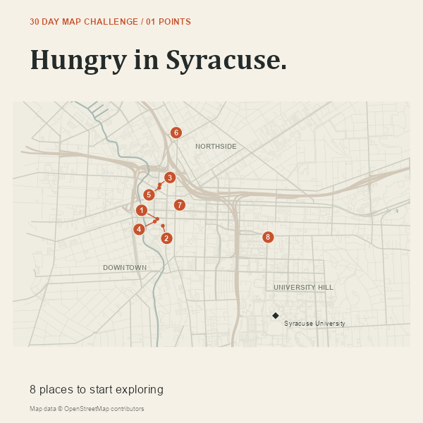
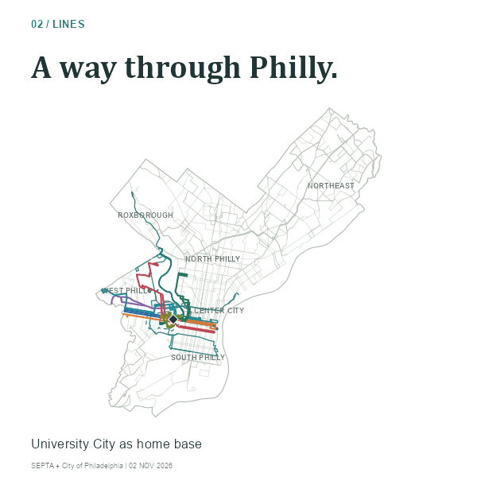
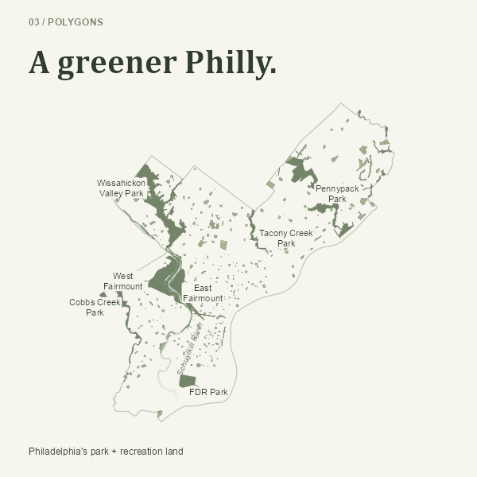
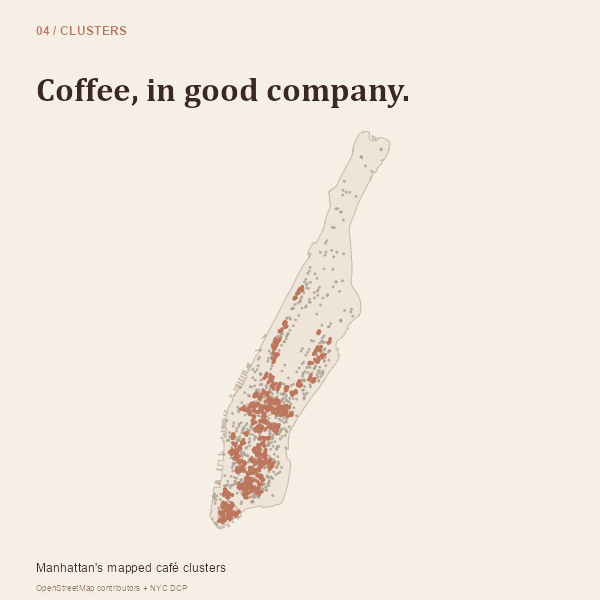

# 30DayMapChallenge2026

Maps by **Terry Boxuan Xu** for the [2026 #30DayMapChallenge](https://30daymapchallenge.com/), with the University of Pennsylvania MUSA community. #teamMUSA

## Maps

| Day | Theme | Map | Code |
|---|---|---|---|
| 01 | Points | [Hungry in Syracuse](Maps/day01_points_syracuse_food.png) | [R script](Scripts/day01_points_syracuse_food.R) |
| 02 | Lines | [A way through Philly](Maps/day02_lines_philadelphia_buses_01_citywide.png) | [R script](Scripts/day02_lines_philadelphia_buses.R) |
| 03 | Polygons | [A greener Philly](Maps/day03_polygons_philadelphia_parks.png) | [R script](Scripts/day03_polygons_philadelphia_parks.R) |
| 04 | Clusters | [Coffee, in good company](Maps/day04_clusters_manhattan_cafes.png) | [R script](Scripts/day04_clusters_manhattan_cafes.R) |

### Day 01 — Hungry in Syracuse

A restaurant guide inspired by my undergraduate years in Syracuse and the challenge of finding somewhere good to eat. Eight locations provide a starting point for a dinner out. The numbers identify places; they are not rankings.

[](Maps/day01_points_syracuse_food.png)

### Day 02 — A way through Philly

A bus map built around 34th & Walnut, near Weitzman, where many of my trips begin and end. The map highlights eight daytime routes with boarding stops within 450 metres straight-line distance of that intersection, alongside the wider network. Scheduled service is for Monday, November 2, 2026.

[](Maps/day02_lines_philadelphia_buses_01_citywide.png)

Companion images: [boarding guide](Maps/day02_lines_philadelphia_buses_02_boarding.png) · [individual routes](Maps/day02_lines_philadelphia_buses_03_routes.png).

### Day 03 — A greener Philly

I love parks and want to explore more of Philadelphia. This map shows the shapes of park and recreation land, from small neighborhood sites to larger landscapes. Colors group sites by their mapped area; they do not measure tree cover or park quality.

[](Maps/day03_polygons_philadelphia_parks.png)

### Day 04 — Coffee, in good company

Manhattan's mapped café clusters, with the entire island at left and enlarged views of the Upper West/East Sides, Midtown, and Lower Manhattan at right. Terracotta identifies clustered cafés; gray shows mapped cafés outside clusters. Light envelopes illustrate the groups.

[](Maps/day04_clusters_manhattan_cafes.png)

## Repository layout

```text
Scripts/       Daily entry scripts: dayNN_theme_topic.R
R/             Rendering, download, and preparation functions
Data/          Cached source and derived data, organized by day
Maps/          Final map images: dayNN_theme_topic.png
  Thumbnails/  Square gallery previews
Submissions/   Metadata and thumbnail files for the MUSA gallery
```

The organization follows [Elizabeth Delmelle's example](https://github.com/ECDelmelle/30DayMapChallenge2026). Open `30DayMapChallenge2026.Rproj` in RStudio, or set the working directory to the repository root.

## Reproduce the maps

Install the required packages once:

```r
install.packages(c("sf", "ggplot2", "jsonlite", "ragg", "httr2", "data.table", "digest", "png"))
```

Run a daily script from the repository root:

```r
source("Scripts/day01_points_syracuse_food.R", encoding = "UTF-8")
source("Scripts/day02_lines_philadelphia_buses.R", encoding = "UTF-8")
source("Scripts/day03_polygons_philadelphia_parks.R", encoding = "UTF-8")
source("Scripts/day04_clusters_manhattan_cafes.R", encoding = "UTF-8")
```

The bundled data supports offline rendering. Day 2 includes a compact derived dataset; its large raw GTFS archive is downloaded only when rebuilding from the original feed. Download and preparation helpers are in `R/`. Arial and Cambria are used for text; substitute available font families on other systems.

## Sources and interpretation

- **Day 1:** [OpenStreetMap contributors](https://www.openstreetmap.org/copyright), Overpass, Nominatim, and official restaurant websites. Addresses, location provenance, and source links are in [the restaurant table](Data/day01_points/restaurants.csv). Check current menus and opening hours before visiting.
- **Day 2:** [SEPTA GTFS v202611010](https://github.com/septadev/GTFS/releases/tag/v202611010), [Philadelphia City Limits](https://opendataphilly.org/datasets/city-limits/), and the city's [Business Improvement Districts](https://opendataphilly.org/datasets/business-improvement-districts/) layer. Bus geometry is clipped to the city boundary. All scheduled variants on the selected date are included; live detours, departures, and individual trip destinations can differ. The University City District service area is used to identify routes serving the area. See [the route guide](Data/day02_lines/derived/route-guide.csv).
- **Day 3:** [Philadelphia Parks & Recreation](https://services.arcgis.com/fLeGjb7u4uXqeF9q/arcgis/rest/services/Parks/FeatureServer), City Limits, and [Philadelphia Water Department hydrology](https://opendataphilly.org/datasets/hydrology/). The map covers PPR-managed or maintained land, not every green space. Site areas are computed after clipping to the city, in NAD83 / UTM zone 18N. The Schuylkill River fade is a visual treatment, not a measurement. The Frosted Fern palette is credited to Macarons & Mimosas.
- **Day 4:** [OpenStreetMap contributors](https://www.openstreetmap.org/copyright) and [NYC Department of City Planning borough boundaries](https://data.cityofnewyork.us/City-Government/Borough-Boundaries/gthc-hcne). A 140-metre DBSCAN neighborhood with minPts=5 identifies groups among 1,271 mapped café locations after removing five likely duplicates. This is an incomplete geographic snapshot, not a census or a measure of café quality. Methods and checks are in [the methods file](Data/day04_clusters/methods.json).

See [Data/README.md](Data/README.md) for the cached files, limitations, and source terms. Third-party data remains subject to its original license and attribution requirements.

## MUSA gallery

The full code, data, and map images belong in this repository. The files in `Submissions/` contain only the thumbnails and Markdown entries needed by the shared [Weitzman-MUSA repository](https://github.com/weitzman-musa/30DayMapChallenge). They are prepared for the gallery workflow; no pull request has been submitted.
